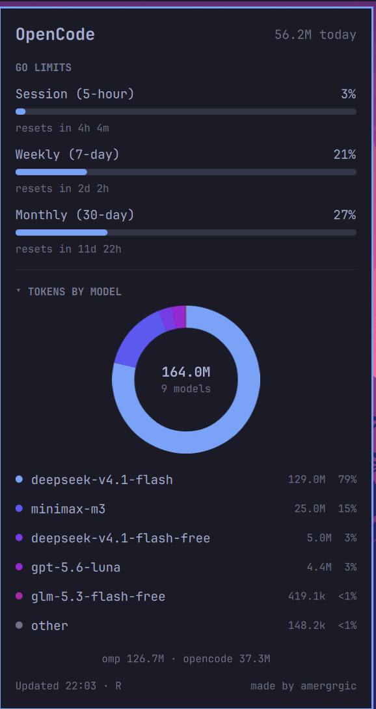

# OpenCode Go Usage (Omarchy bar widget)



One bar icon: the **OpenCode Go** allowance windows, today's tokens, and
per-model totals — counted from **every** client on this machine, not just
one.

The three meters are Go's: Session (5-hour), Weekly (7-day), Monthly (30-day),
each model's monthly dollar limit split 20% / 50% / 100%. OpenCode Console
(a.k.a. Zen) is pay-as-you-go credits, so its sessions are counted in the
tokens but have no windows to meter.

Replaces `io.github.mrc04d.opencode-go`, which read `opencode.db` alone and
therefore stopped counting the moment you used a different client.

## What it shows

- **GO LIMITS** — Session (5-hour), Weekly (7-day), Monthly (30-day) with a
  meter and a live reset countdown. Source: the OpenCode Go usage endpoint;
  hidden for an account without a Go subscription.
- **Today** — tokens, plus the scan time in the footer (`Updated HH:mm · R`).
- **Tokens by model** — a share ring with the total in the middle, then a
  legend row per wedge: model, tokens and share. The five heaviest models get
  their own wedge; anything past them is folded into a grey `other` wedge so
  the shares still add up to 100%. Hover a row for the input / output / cache
  split and the clients that fed it (`via omp + opencode`). The same model id
  from two clients is one row. Click the section title, or press **M**, to
  collapse it; the state lasts for the session.

The ring is drawn on a `Canvas` from the theme accent (hue and lightness step
per wedge), so it follows a theme change without a hard-coded palette.
- **Sources footer** — how many tokens each client contributed, then one row
  with the scan time on the left and `made by amergrgic` on the right; the
  credit opens https://amergrgic.com.

The widget hides itself until a scan finds something.

## Where the tokens come from

Tokens are not Go-only: any session whose provider id starts with `opencode`
counts, which covers `opencode-go` (subscription) and `opencode` (Console /
Zen pay-as-you-go, including the free-tier `-free` models).

| Client | Store | Read |
|---|---|---|
| omp / pi | `~/.pi/agent/sessions`, `~/.omp/agent/sessions` | JSONL, `message.usage` on assistant messages |
| opencode v2 | `~/.local/share/opencode/opencode.db` | `session_message` projection (nested `model.providerID`) |
| opencode v1 forks | `~/.local/share/opencode*/*.db` | legacy flat `message` table |
| Hermes | `$HERMES_HOME/state.db`, `~/.hermes/state.db`, `~/.hermes/profiles/*/state.db` | `sessions` token columns |

Only `opencode*` providers are counted, so a Claude or Codex session that ran
through the same client is not double-counted against this widget — those stay
with Omarchy's own `omarchy.agents` collectors.

A source that is missing or broken is skipped; the others still report. The
scan reads local files only and takes well under a second, so **there is no
cache of token stats**: every refresh re-reads the stores. A stale cache is
exactly what makes a usage widget silently stop updating. Only the network
probe is cached (5 minutes).

## Settings

| Key | Default | What it does |
|---|---|---|
| `refreshSec` | `60` | Rescan interval, 15–3600 |

Set with `omarchy bar set io.github.amergrgic.opencode-usage refreshSec 30`.

## Usage

- Click the icon to open the panel, **Esc** to close.
- **R** or **Enter** forces a rescan (also refreshes the limit windows).
- **M** collapses the model list.
- Middle-click the bar icon forces a rescan without opening the panel.

## Install

```sh
omarchy plugin add <this-repo-url> --enable
omarchy bar move io.github.amergrgic.opencode-usage --section right
```

The collector is stdlib-only Python 3.

## Key resolution

1. `OPENCODE_GO_API_KEY`, then `OPENCODE_API_KEY`
2. `~/.local/share/opencode/auth.json` → `opencode-go.key`
3. opencode v2 `credential` table in `opencode.db` (`integration_id = 'opencode-go'`)

The key is only ever sent to `https://opencode.ai/zen/go/v1/usage` as a Bearer
token; it is never written to a record, cache, or log.

## Tests

```sh
python3 -m unittest discover -s tests -v
```

The tests build synthetic stores for every source and assert the per-model and
per-day aggregation, the provider filter, and row de-duplication.
